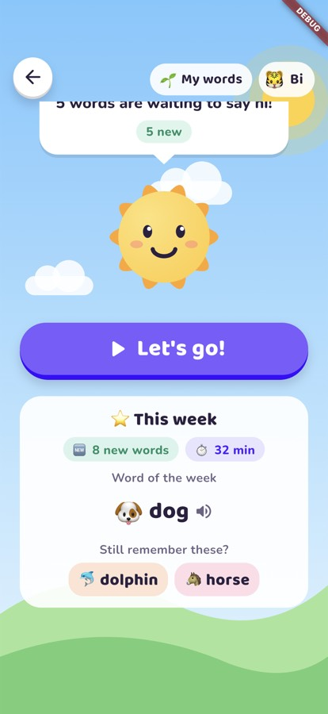
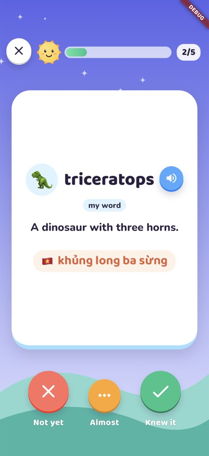
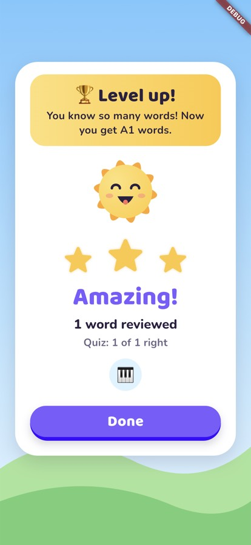
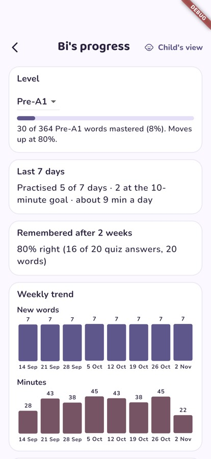

# Voca Swiper ☀️

**A friendly English vocabulary app for kids.** Children swipe through picture cards, hear each word read aloud, and practise a few minutes a day. Sunny, the app's mascot, brings back each word just before it would be forgotten, so the words stick.

Made for Vietnamese-speaking children aged about 4–15, on Android and iOS phones and tablets. It works fully offline and has no ads, no tracking and no accounts.

<p>
  
  
  
  
</p>

## For kids

- **Swipe cards.** Each card has a picture, the word read aloud, a short meaning and the Vietnamese translation. Answer *Knew it*, *Almost* or *Not yet*.
- **Smart reviews.** Words come back at the right time (spaced repetition), so a short daily session is enough.
- **Little quizzes.** Hear a word and pick its picture, choose the right meaning, or spell it with letter tiles.
- **A quick word check at the start.** A short, playful test finds the right level, and kids pick favourite topics such as animals, space or sports.
- **Levels that grow with them.** From Pre-A1 to B1 (about 1,500 words). When most words at a level are learned, the child moves up, with a celebration.
- **"This week" card.** New words, minutes practised and a word of the week, right on the home screen.

## For parents

The parent area is locked with a PIN. In it you can:

- **Add each child** with a nickname, avatar, age and daily goal. Each child has their own progress.
- **See a dashboard** with words mastered, days practised, weekly trends, how much is remembered after two weeks, and the words your child finds hardest.
- **Add your own words** from homework or books. They come first in your child's next sessions.
- **Set the level.** Change it, or keep it fixed. If practice gets too hard, the app suggests stepping back a level.
- **Set reminders**: a daily practice reminder and an optional Sunday summary of the week. They are local notifications, with nothing sent anywhere.

## Privacy

- Everything stays on the device. The app makes no network calls.
- No ads, analytics or trackers.
- A child profile stores only a nickname, age and learning progress.

## Install and run

You need the [Flutter SDK](https://docs.flutter.dev/get-started/install) (Dart 3.9 or newer) and an Android or iOS device or emulator.

```bash
git clone <this repo> && cd voca-swiper
flutter pub get
flutter run
```

On first launch you set a parent PIN, add a child, and hand over the device.

## For developers

Built with Flutter, Riverpod, Drift (SQLite) and go_router. The word bank is written in-house and bundled with the app; content licences are in [`assets/LICENSES.md`](assets/LICENSES.md).

```bash
./init.sh     # pub get, format check, analyze, all tests
```

```
lib/
  core/       pure-Dart learning logic: SM-2 scheduler, sessions, quizzes, placement, levels
  data/       Drift database and repositories
  features/   screens and Riverpod providers (session, parent, placement, recap, …)
content_pipeline/   builds the bundled word bank
integration_test/   on-device checks (phone and tablet)
docs/               SPEC.md (product and technical spec), adr/ (architecture decisions)
```

This project is built with an AI coding agent. Its working files are [`AGENTS.md`](AGENTS.md) (the rules), `feature_list.json` (the feature tracker), `progress.md` (the session log) and `init.sh` (the check that runs before every change).
